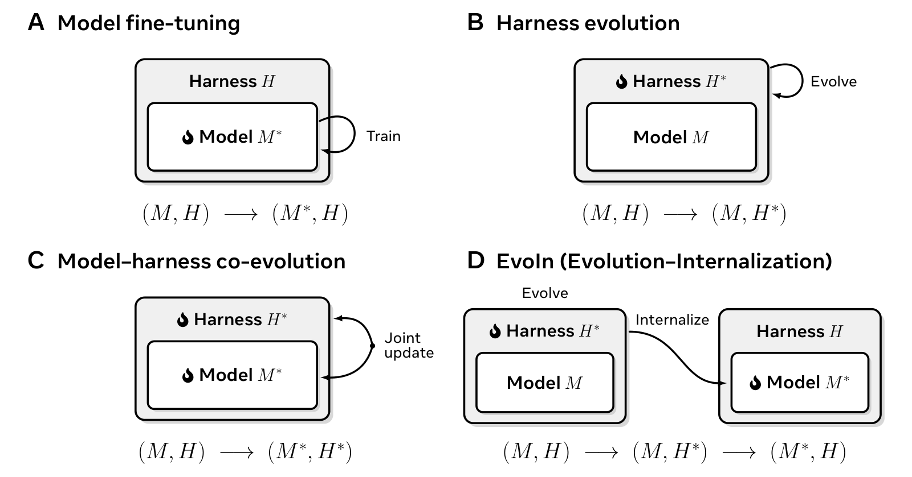
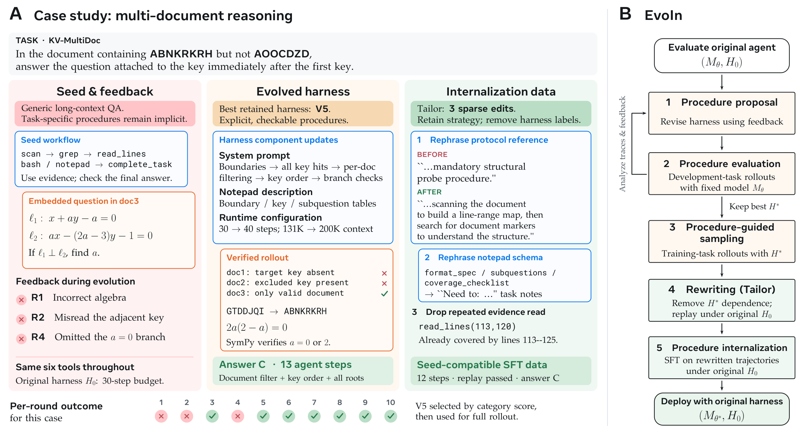

<div align="center">

# EvoIn: Bridging Evolution and Internalization for Agent Fine-Tuning

Shihan Dou<sup>\*</sup>, Shaofan Liu<sup>\*</sup>, Zhonghang Lu<sup>\*</sup>, Jiahang Lin, Shichun Liu,
Binghai Wang, Jiajie Jin, Guanting Dong, Tao Gui, Qi Zhang, Xuanjing Huang

Fudan University &nbsp;·&nbsp; Renmin University of China

<sup>\*</sup>Equal contribution


</div>

## Overview

Recent work improves agents by jointly evolving their harnesses and models, but often bundles
new tools, new decision-making procedures, and model adaptation to the evolved harness under a
single notion of agent improvement. **EvoIn** instead asks how an agent can improve its
*decision-making procedures*, and bridges harness **evo**lution with model **in**ternalization:

- the agent analyzes its own execution traces, and evolves and validates better decision
  procedures by temporarily instantiating them in the harness;
- the validated procedures guide the agent to generate improved trajectories;
- the trajectories are rewritten into self-contained reasoning that no longer refers to the
  evolved harness, expressing the induced decision logic as the model's own reasoning;
- the model is fine-tuned on the rewritten trajectories under the **original** harness, so the
  improved decision-making persists without the evolved harness at inference time.

<p align="center">
  
</p>
<p align="center"><em>Four paradigms for improving language agents. EvoIn (D) first evolves the
harness to discover better decision procedures, then internalizes them into the model and returns
to the original harness.</em></p>

## Method

EvoIn has five stages: **procedure proposal**, **procedure evaluation**, **procedure-guided
sampling**, **rewriting** with the Tailor pipeline, and **procedure internalization**.

<p align="center">
  
</p>
<p align="center"><em>(A) A multi-document reasoning case: feedback from the seed harness, the
evolved harness that makes its procedure explicit, and the Tailor edits that keep the strategy
while removing harness labels. (B) The five stages of EvoIn.</em></p>

## Highlights

- **In-domain:** on 23 long-context categories (2,300 examples), EvoIn raises the Pass rate of
  Qwen3.5-35B-A3B from 35.96% to **46.83%** (+10.87), and improves all seven task groups.
- **Out-of-domain:** on six unseen benchmarks (2,064 examples), Pass rises from 18.99% to
  **28.20%** (+9.21), with gains on every benchmark and up to +19.69 on a single one.
- **Rewriting is necessary:** a model fine-tuned on unrewritten trajectories cites instructions
  and tools that do not exist in the original harness, runs out of turns on 19.4% of OOD
  examples (6.1% for EvoIn), and keeps almost none of the OOD gain.
- **Adaptive procedures:** the model learns to decide how to solve a task before solving it, for
  example checking a document's length to choose between reading it in full and searching it.
- **Other model families:** applied to Gemma-4-31B-it, EvoIn also improves ID and OOD Pass.

## Main Results

Qwen3.5-35B-A3B before (Base) and after EvoIn fine-tuning, both evaluated with the same seed
harness (%).

| In-domain task group | N | Pass (Base → EvoIn) | Score (Base → EvoIn) |
|---|---:|---:|---:|
| Multi-document key retrieval | 300 | 57.00 → **63.33** | 57.00 → **63.33** |
| Evidence-grounded QA | 400 | 52.25 → **61.50** | 55.03 → **64.93** |
| Structured-data reasoning | 300 | 44.00 → **61.33** | 44.00 → **61.33** |
| Log and dialogue tracking | 300 | 53.00 → **75.00** | 55.14 → **76.78** |
| In-context learning | 200 | 26.00 → **39.00** | 26.00 → **39.00** |
| Document-grounded generation | 300 | 22.00 → **36.00** | 22.00 → **36.00** |
| Complex instruction following | 500 | 7.60 → **9.20** | 43.75 → **49.41** |
| **All 23 categories** | 2,300 | 35.96 → **46.83** | 44.58 → **56.40** |

| Out-of-domain benchmark | N | Pass (Base → EvoIn) | Score (Base → EvoIn) |
|---|---:|---:|---:|
| AA-LCR | 100 | 27.00 → **37.00** | 27.00 → **37.00** |
| BrowseComp-LongContext | 295 | 12.54 → **13.56** | 12.54 → **13.56** |
| LongBench v2 | 503 | 33.20 → **44.73** | 33.20 → **44.73** |
| MRCR | 800 | 2.00 → **8.88** | 32.55 → **76.31** |
| Oolong | 300 | 43.33 → **60.33** | 44.58 → **61.42** |
| Table-Longer | 66 | 22.73 → **42.42** | 22.73 → **42.42** |
| **Average** | 2,064 | 18.99 → **28.20** | 31.02 → **54.49** |

| Ablation | ID Pass | ID Score | OOD Pass | OOD Score |
|---|---:|---:|---:|---:|
| Base | 35.96 | 44.58 | 18.99 | 31.02 |
| Seed-harness SFT (no evolution) | 37.83 | 47.25 | 18.36 | 43.16 |
| EvoIn w/o Tailor (no rewriting) | 45.00 | 54.89 | 19.67 | 45.70 |
| **EvoIn** | **46.83** | **56.40** | **28.20** | **54.49** |

## Pipeline

| Paper component | Code |
|---|---|
| Procedure proposal; proposal system prompt (Appendix) | `evoin/evolve/proposal.py`, `evoin/evolve/prompts/proposal_system.md` |
| Analysis agent | `evoin/evolve/analysis_agent.py` |
| Evolution query template (Appendix) | `evoin/evolve/analysis.py` (`render_evolution_query`) |
| Candidate validation | `evoin/evolve/validate.py`, runtime validation in `evoin/evolve/evolve.py` |
| Procedure evaluation and selection of H* | `evoin/evolve/evolve.py` (`evolve_class`) |
| Rollout scored by the task evaluator | `evoin/evolve/rollout.py` (`run_rollout`), `evoin/runtime/judge.py` |
| Procedure-guided sampling | `run_rollout` with H* on D_train |
| Tailor | `evoin/tailor/` (`pipeline.run`) |
| Rewriting, repair, and checking prompts (Appendix) | `evoin/tailor/prompts/{rewrite,repair,quality}.md` |
| Seed harness H0 | `harness/seed/` |

The proposal system prompt and the three Tailor prompts are the texts reproduced in the paper
appendix; the evolution query follows the appendix template section by section.

## Not included

- Supervised fine-tuning code and configurations.
- Model clients and serving configurations.
- The in-domain training data and the Table-Longer benchmark, which cannot be released, and the
  evolved harnesses and run logs derived from them.
- Evaluation scripts for the out-of-domain benchmarks.

## Citation

```bibtex
@misc{dou2026evoin,
  title  = {EvoIn: Bridging Evolution and Internalization for Agent Fine-Tuning},
  author = {Dou, Shihan and Liu, Shaofan and Lu, Zhonghang and Lin, Jiahang and Liu, Shichun and
            Wang, Binghai and Jin, Jiajie and Dong, Guanting and Gui, Tao and Zhang, Qi and
            Huang, Xuanjing},
  year   = {2026}
}
```
